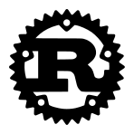

# Hi there, I'm Lexus 👋

### Software developer · Founder of Musorum · fourtexec crew

I build software from the inside out: operating systems, desktop tools, and web experiments.

[Portfolio](https://dr-lexus-dr.github.io) · [Musorum](https://musorum.com) · [fourtexec](https://fourtexec.site)

---

### 👨‍💻 A little about me

- Building **[bOS](https://github.com/dr-lexus-dr/bos)**, a terminal-first operating system for x86-64 UEFI, written in Rust.
- Creating useful tools with **Python**, including **[bSORT](https://github.com/dr-lexus-dr/bSORT)**, a desktop file organiser.
- Founder of **[Musorum](https://musorum.com)** and part of the **[fourtexec](https://github.com/fourtexec)** engineering crew.
- Interested in systems programming, automation, and open source.

### 🛠️ Technologies in my projects

  &nbsp;
  &nbsp;
  &nbsp;
  &nbsp;
  &nbsp;
  &nbsp;
  &nbsp;
  &nbsp;
  &nbsp;

---

**From a small experiment to a working system.**

[Explore my repositories](https://github.com/dr-lexus-dr?tab=repositories) · [Visit my website](https://dr-lexus-dr.github.io)

