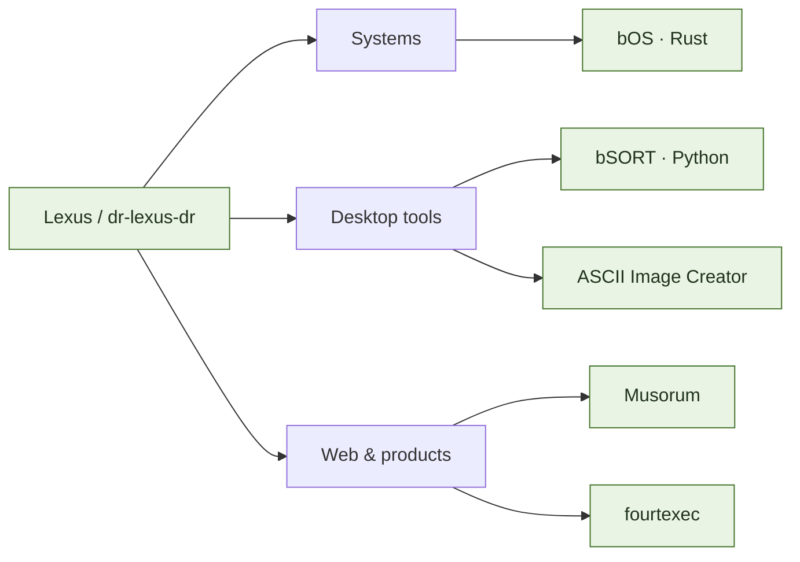
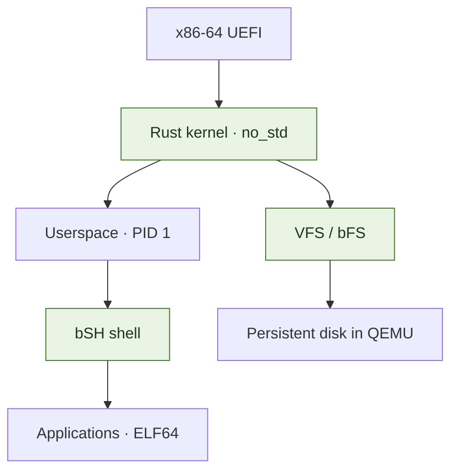

# Hi there, I'm Lexus 👋

### Software developer · Founder of Musorum · fourtexec crew

I build software from the inside out: operating systems, desktop tools, and web experiments.

[Portfolio](https://dr-lexus-dr.github.io) · [Musorum](https://musorum.com) · [fourtexec](https://fourtexec.site)

---

### A little about me

- Building **[bOS](https://github.com/dr-lexus-dr/bos)**, a terminal-first operating system for x86-64 UEFI, written in Rust.
- Creating useful tools with **Python**, including **[bSORT](https://github.com/dr-lexus-dr/bSORT)**, a desktop file organiser.
- Founder of **[Musorum](https://musorum.com)** and part of the **[fourtexec](https://github.com/fourtexec)** engineering crew.
- Interested in systems programming, automation, and open source.

### Technologies in my projects

  
  
  
  
  

Rust / no_std · Python / CustomTkinter / OpenCV · HTML / CSS / JavaScript

### Selected projects

| Project | What I'm building | Technologies |
| :--- | :--- | :--- |
| **[bOS](https://github.com/dr-lexus-dr/bos)** | A small operating system with bSH, bFS, and userspace programs. In development. | Rust, x86-64, UEFI |
| **[bSORT](https://github.com/dr-lexus-dr/bSORT)** | Desktop file organisation with configurable rules, themes, and localisation. | Python, CustomTkinter |
| **[ASCII Image Creator](https://github.com/dr-lexus-dr/ASCII-Image-Creator)** | An image-to-text experiment using grayscale character mapping. | Python, OpenCV |
| **[Cesar](https://github.com/dr-lexus-dr/Cesar)** | Caesar cipher encryption and decryption utilities. | Python |
| **[Calculator Collection](https://github.com/dr-lexus-dr/Calculator-Collection)** | A collection of Python calculator implementations. | Python |

### Explore the work

### Inside bOS

A simplified map of the project. See the [architecture](https://github.com/dr-lexus-dr/bos/blob/main/docs/ARCH.md) and [current status](https://github.com/dr-lexus-dr/bos/blob/main/docs/STATUS.md) for implementation details and limitations.

---

**From a small experiment to a working system.**

[Explore my repositories](https://github.com/dr-lexus-dr?tab=repositories) · [Visit my website](https://dr-lexus-dr.github.io)

